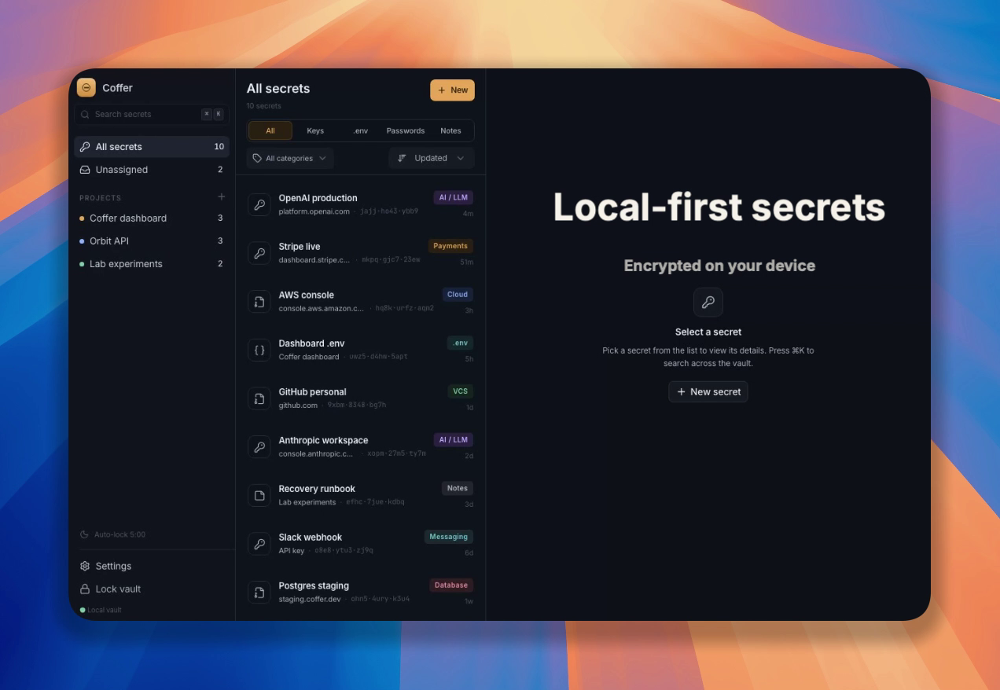
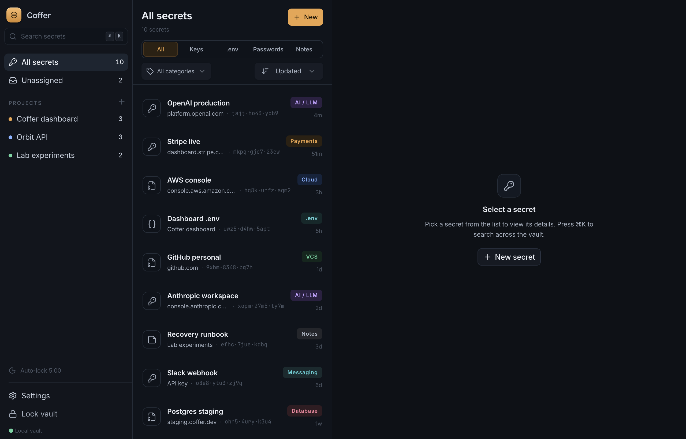
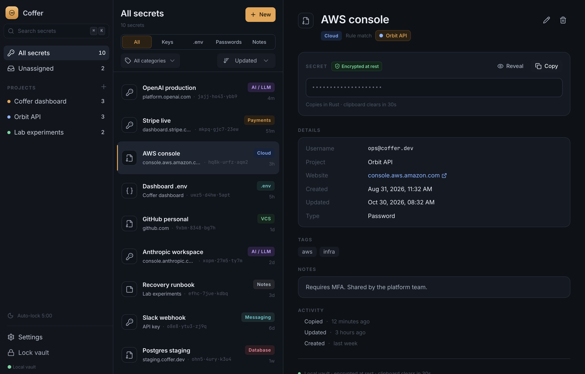
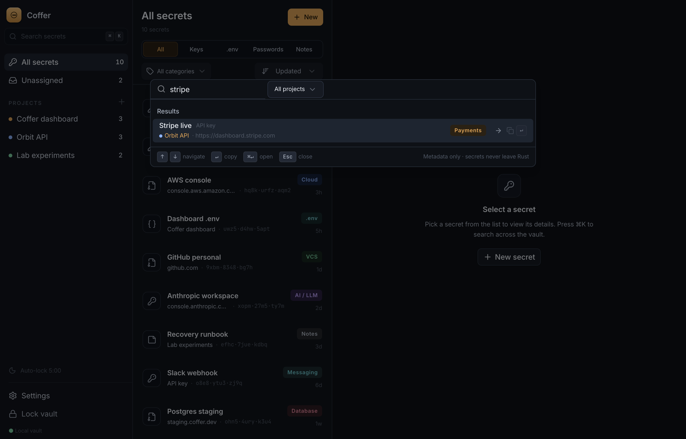
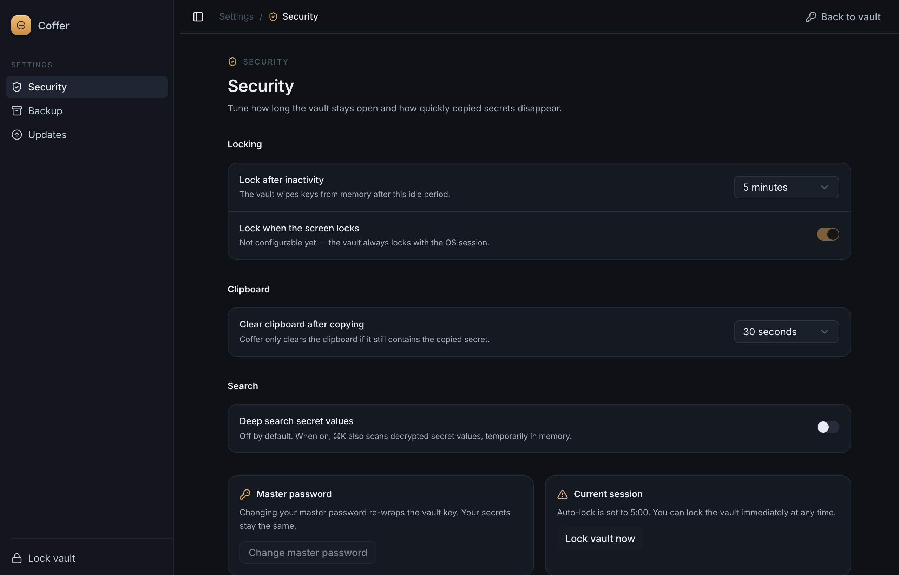

<p align="center">
  
</p>

<h1 align="center">Coffer</h1>

<p align="center">
  <strong>Local-first, encrypted secrets manager for developers.</strong><br />
  API keys, <code>.env</code> fragments, and passwords — encrypted on your device.
  No account. No cloud. No telemetry.
</p>

<p align="center">
  <a href="https://github.com/luozhouyang/coffer-desktop/actions/workflows/ci.yml"></a>
  <a href="https://github.com/luozhouyang/coffer-desktop/releases/latest"></a>
  
  <a href="LICENSE"></a>
</p>

<p align="center">
  <a href="https://github.com/luozhouyang/coffer-desktop/releases/download/demo-assets/coffer-demo.mp4">
    
  </a>
  <br />
  <sub>Click the preview to watch the short demo.</sub>
</p>

> **Status:** early (`0.x`). The vault format and IPC contract are stable enough for daily use, but expect changes before `1.0`.

## Why Coffer

Credentials are scattered across notes, shell history, `.env` files, and screenshots. Cloud password managers fix that by giving your secrets to someone else. Coffer keeps them in a single **SQLCipher-encrypted vault on your machine**, with a UI built for the way developers actually work: search first, copy fast, stay out of the way.

## Features

- **Encrypted at rest.** The vault is a SQLCipher database. Your master password derives a key with Argon2id; the database key is derived with HKDF. The master password is never stored.
- **Secrets stay in Rust.** Values are masked by default and never cross IPC unless you explicitly reveal one. Copying happens inside the Rust process — the value is not handed back to the UI.
- **Fast, fuzzy search.** Press <kbd>⌘</kbd><kbd>K</kbd> from anywhere. Search titles, usernames, URLs, notes, and tags, in Chinese or English (FTS5 trigram index with a short-query fallback).
- **Projects, tags, and smart grouping.** Organize by repository or service; categories are suggested by local rules and can be overridden.
- **Locked by default.** Auto-lock after inactivity, lock with the OS session, and clear the clipboard after copying (only if it still holds the copied secret).
- **Encrypted backups.** Export the whole vault as one password-protected `.coffer` file; restore it on a new machine from the setup screen.
- **Touch ID on macOS.** Optional biometric unlock on supported Macs.
- **Signed auto-updates.** Releases are signed with an offline minisign key and verified by the app before installing.
- **Native on macOS, Windows, and Linux.** Signed and notarized on macOS; NSIS/MSI on Windows; AppImage, deb, and rpm on Linux.

## Security model

Coffer protects data **at rest and while the vault is locked**:

- Argon2id derives a key that wraps a randomly generated master key; only the wrapped key is stored.
- The database key is derived from the master key with HKDF and passed to SQLCipher.
- No telemetry, analytics, or crash reporting. The only background network request is the signed update check against GitHub Releases.
- There is **no password recovery**. If you forget the master password, the vault cannot be opened — this is the point, not an oversight.

It does **not** attempt to defend against malware running in your unlocked session, keyloggers, screen capture, or an attacker with administrator access while the vault is open. As with any local secrets tool, the security of the unlocked session is the security of the vault.

## Download

Get the latest build from the [releases page](https://github.com/luozhouyang/coffer-desktop/releases/latest).

| Platform | Artifacts | Notes |
|---|---|---|
| macOS | DMG (Apple Silicon, Intel), `.app.tar.gz` | Signed and notarized |
| Windows | NSIS `.exe`, MSI | Not code-signed; SmartScreen may warn on first launch |
| Linux | AppImage, `.deb`, `.rpm` | Not code-signed |

The first launch creates your vault. Choose a strong master password and keep it safe; automatic updates are available from `0.2.0` onward.

## Screenshots

| Vault | Item detail |
|---|---|
|  |  |

| Command palette | Security settings |
|---|---|
|  |  |

## Getting started

### Prerequisites

- Node.js 22+ and pnpm 10
- Rust stable
- The [Tauri prerequisites](https://v2.tauri.app/start/prerequisites/) for your OS

### Develop

```bash
pnpm install
pnpm dev          # browser preview, in-memory mock backend
pnpm tauri dev    # native app with the real Rust backend
```

`pnpm dev` runs the UI in a browser against an in-memory mock (no real vault). Use `pnpm tauri dev` for the full application, including SQLCipher, clipboard handling, and Touch ID.

### Checks

```bash
pnpm typecheck
pnpm test
cargo test --manifest-path src-tauri/Cargo.toml
cargo clippy --manifest-path src-tauri/Cargo.toml --all-targets -- -D warnings
```

### Build

```bash
pnpm tauri build
```

Updater artifacts are only produced when `TAURI_SIGNING_PRIVATE_KEY` is set; the release workflow supplies it from repository secrets.

## Architecture

```
React + TypeScript (UI only)
        │  typed IPC (tauri-specta) — metadata by default
Rust backend (commands / crypto / vault / classify)
        │  SQLCipher
Encrypted vault (vault.db + vault.meta.json)
```

Coffer is a Tauri v2 app: a React + TypeScript UI on top of a Rust backend, with typed IPC generated by tauri-specta.

The UI never receives the whole vault. Secrets are copied inside Rust, revealed only on explicit request, and automatically hidden again. Search indexes are contentless FTS5 tables maintained by the backend.

## Releasing

```bash
pnpm version:set 0.3.0
git commit -am "chore: release v0.3.0"
git tag v0.3.0
git push origin main v0.3.0
```

CI verifies the code, builds signed/notarized macOS artifacts plus Windows and Linux installers, and creates a **draft** release with `latest.json` and `.sig` files. Publish the draft to make the version visible to the in-app updater. The tag must match the app version.

## Data and backups

- The vault lives in your OS application-data directory (`vault.db`, `vault.meta.json`).
- **Settings → Backup** exports a single encrypted `.coffer` archive protected by your master password.
- Restore is offered on the first-run screen of a new installation.
- Backups are not updated automatically: after changing your master password, older backups still require the password they were created with.

## Contributing

Issues and pull requests are welcome. Before opening a PR, run the checks above; CI runs the same suite on macOS, Windows, and Linux.

## License

[MIT](LICENSE)
